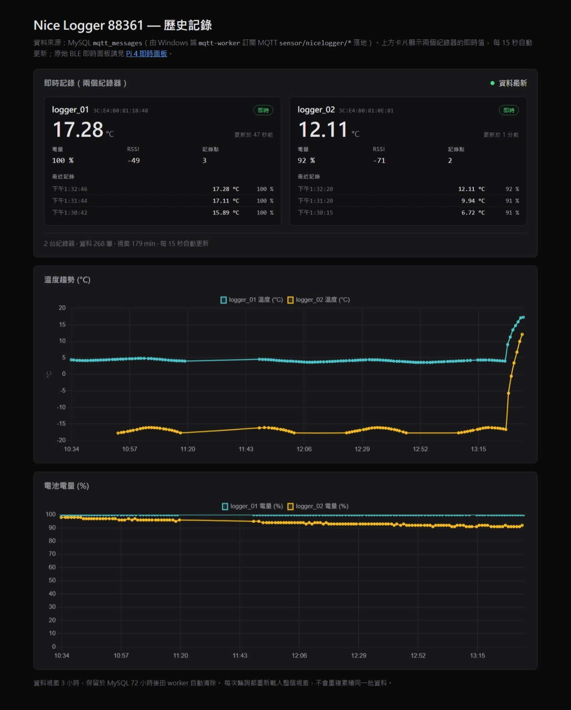

# nice-logger-pi-mqtt

AZ Instrument **88361 Nice Logger** 的 Raspberry Pi 端完整實作：
BLE 廣播閘道器 → MQTT → MySQL 遙測管線、FastAPI 即時控制面板，
以及 `/nicelogger-history/` 歷史查詢頁（MySQL 直讀）。



## 系統架構

```
88361 logger_01 / logger_02（BLE 廣播）
        │  Pi 4：backend/nicelogger_gateway.py（systemd 常駐）
        ▼
MQTT broker  mqtt-mosquitto :1883        （Windows Docker）
        ├──▶ Pi FastAPI：backend/nice_logger/   → http://<pi>:8000/   即時控制面板
        └──▶ mqtt-worker（Windows）              → MySQL mqtt_store.mqtt_messages
                                                        │
                                                        ▼
                              frontend/api/records.php（MySQL 直讀端點）
                                                        │
                                                        ▼
                              http://127.0.0.1/nicelogger-history/   歷史頁
```

## Repo 結構

| 路徑 | 內容 |
|---|---|
| `backend/nicelogger_gateway.py` | BLE 廣播 → MQTT 發布器（Pi 上常駐，systemd `nicelogger_gateway.service`） |
| `backend/nice_logger/` | FastAPI 面板：`ble_client.py`（BLE 控制）、`mqtt_feed.py`（MQTT 訂閱）、`api.py`、`static/` |
| `backend/deploy/systemd/` | 兩個 systemd unit 檔 |
| `frontend/` | 歷史頁靜態檔（`index.html` / `app.js` / `style.css`）＋ `api/records.php` |
| `docs/protocol/` | 88361 BLE protocol 完整筆記（`SKILL.md` ＋ `references/`） |
| `docs/nicelogger-history-webui.jpeg` | 歷史頁畫面 |

## 部署對照

| Repo 路徑 | 部署位置 |
|---|---|
| `backend/nicelogger_gateway.py`、`backend/nice_logger/` | Pi：`/home/kali/nice-logger-pi/` |
| `backend/deploy/systemd/*.service` | Pi：`/etc/systemd/system/` |
| `frontend/*`（含 `api/`） | Windows：`D:\docker\apache\html\nicelogger-history\`（Apache docroot） |
| MySQL 設定 | Apache 容器內 `html/mqtt/config.php`（**不入 git**，以 `DB_HOST` / `DB_NAME` / `DB_USER` / `DB_PASS` 注入） |

`frontend/` 與伺服器上的目錄結構一致，可整包覆蓋；`backend/` 對應 Pi 上 `/home/kali/nice-logger-pi/`。

## 快速開始（Pi 4）

```bash
# 1. 程式
rsync -a backend/nicelogger_gateway.py backend/nice_logger/ kali@<pi>:/home/kali/nice-logger-pi/

# 2. 相依套件（兩套 venv：閘道器用 nicelogger_env，面板用 .venv）
ssh kali@<pi> '/home/kali/nice-logger-pi/nicelogger_env/bin/pip install -r backend/requirements.txt'

# 3. systemd unit
cp backend/deploy/systemd/*.service /etc/systemd/system/ && systemctl daemon-reload \
  && systemctl enable --now nicelogger_gateway.service nice-logger-pi.service
```

閘道器的 MQTT 目標寫在 `backend/nicelogger_gateway.py` 開頭（`MQTT_BROKER` / `MQTT_PORT` /
`MQTT_TOPIC_PREFIX` / `REPORT_INTERVAL`）。

## API

### 歷史頁（Apache，同源）

`GET /nicelogger-history/api/records.php`

```json
{
  "samples": [ { "device_id": "logger_01", "temperature_c": 26.5, "battery_pct": 100,
                "rssi": -83, "log_count": 3, "received_ms": 1793169124000, "topic": "..." } ],
  "latest":  { "logger_01": { ... }, "logger_02": { ... } },
  "updated_ms": 1793169124000,
  "stale": false, "broker_connected": true,
  "count": 228, "window_minutes": 180, "source": "mysql"
}
```

- `samples`：視窗內（預設 180 分鐘）所有紀錄，給趨勢圖用。
- `latest`：每台紀錄器最新一筆，**不受視窗限制**；上游斷線時頁面仍顯示最後已知值＋過期標記。
- 設定來源：`NICELOGGER_CONFIG` → `<apache html>/mqtt/config.php` → 同目錄 `config.php`（見 `frontend/api/config.example.php`）。
- 可調參數：`NICELOGGER_API_WINDOW_MINUTES`、`NICELOGGER_API_MAX_SAMPLES`、`NICELOGGER_API_LATEST_SCAN`。

### Pi 面板（FastAPI，:8000）

| Endpoint | 說明 |
|---|---|
| `GET /api/health` | 服務健康檢查 |
| `GET /api/live` | BLE 即時值（依實作狀態） |
| `GET /api/packets` | 原始 FFF2 封包紀錄 |
| `GET /api/mqtt/status` | MQTT 訂閱狀態 |
| `GET /api/mqtt/records?limit=N` | MQTT 遙測紀錄 |
| `WS /ws` | 前端即時推送 |

## Protocol

完整筆記在 [`docs/protocol/`](docs/protocol/)：

- `SKILL.md` — BLE 服務/characteristic、wire format、opcode 表、notify 欄位索引、部署拓撲、已知坑。
- `references/recorder-config-protocol.md` — `0x53` 寫入 / `0x73` 讀回的配置協定。
- `references/configure-read-path.md` — 查詢路徑的靜態分析與欄位順序。
- `references/deployment-topology-and-url-mapping.md` — URL → 實際後端對照。
- `references/telemetry-pipeline-stall-triage.md` — publisher / broker / subscriber / MySQL 分層排查。
- `references/multi-device-passive-monitoring.md` — 多台紀錄器被動監聽注意事項。
- `references/rea-provider-setup-and-findings.md` — REA 反混淆流程與已驗證結果。

## 已知坑（實測）

- **閘道器只連一次 broker**：舊版 `connect()` 失敗就吞掉例外、永不重連，之後 `publish()` 全部被丟棄，
  但 journal 仍每分鐘印「-> MQTT」。已改為 `connect_async()` 背景重連＋檢查 `publish()` rc＋watchdog；
  判斷依據請看 log 的「已送出／等待重連／發送失敗」標記與 `ss -tnp | grep 1883`。
- **Pi 沒有 RTC**：重開機後系統時鐘會慢數天（UDP/123 被擋），journal 時間戳會錯；
  需要 NTS over TCP/4460 校正。
- **Pi 的區網 IP 是 DHCP 會變**：不要把區網 IP 寫死在小說或指令裡，用 Tailscale 位址。
- **發布間隔 60 秒**：`REPORT_INTERVAL = 60`，短訂閱窗（<90 秒）看不到資料是正常現象，不是故障。
- **broker 日誌大量 `auto-XXXX` 連線**是容器 healthcheck，不是異常。
- **MySQL `mqtt_user` 沒有 UPDATE 權限**：設定頁要改 topics 得用 MySQL root。
- **Apache 反代已停用**：`/nicelogger/` 的反向代理在 2026-10-28 關閉，歷史頁 `/nicelogger-history/`
  本來就是靜態目錄、不受影響。

## 授權

- 本 repo 程式碼：沿用原專案授權。
- `frontend/chart.umd.min.js`、`frontend/chartjs-adapter-date-fns.bundle.js`：Chart.js（MIT）。
